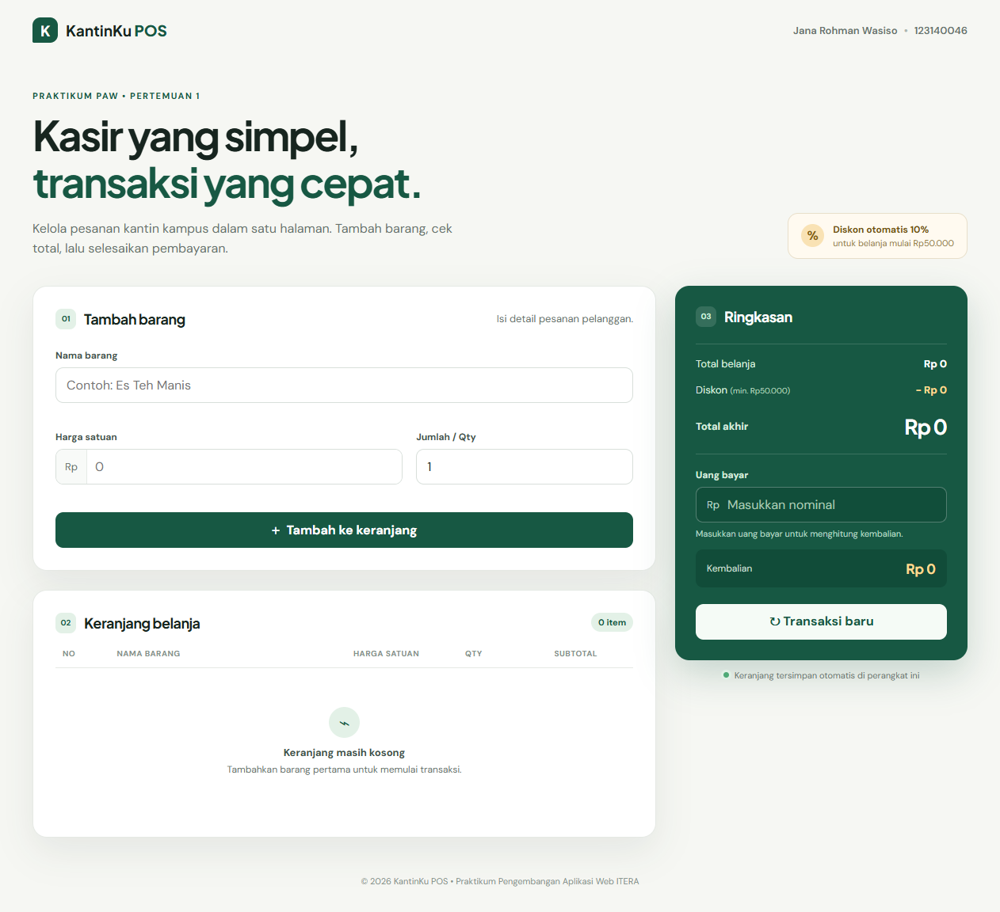
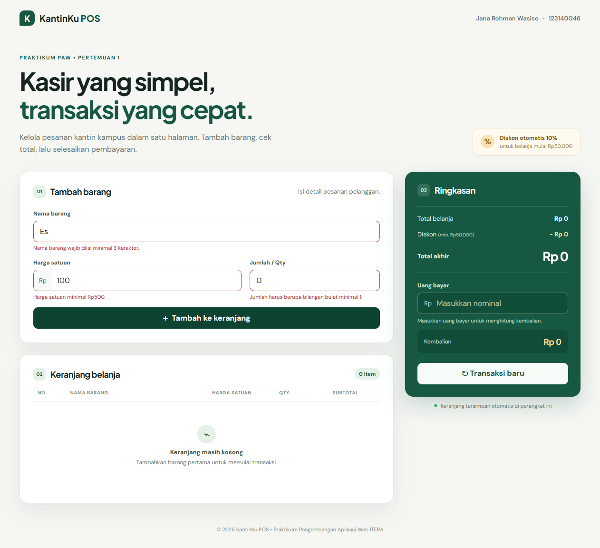
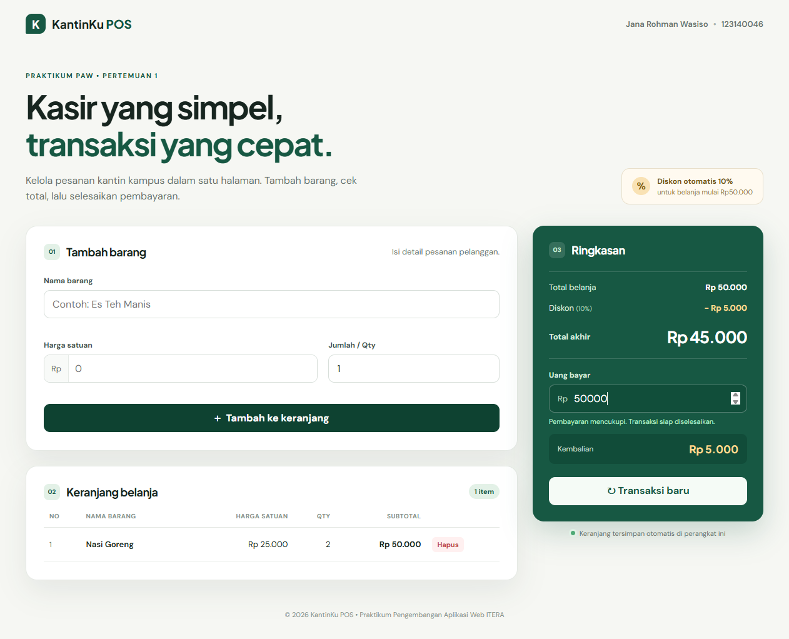

# KantinKu POS

> Tugas Praktikum Pengembangan Aplikasi Web - Pertemuan 1: JavaScript Dasar

## Identitas

| Keterangan | Isi |
| --- | --- |
| Nama | Jana Rohman Wasiso |
| NIM | 123140046 |
| Kelas Praktikum | PAW RB |

## Deskripsi Aplikasi

**KantinKu POS** adalah aplikasi kasir dan keranjang belanja sederhana untuk skenario kantin atau toko kampus. Aplikasi dibuat untuk menggabungkan materi dasar JavaScript: validasi input form, event handler, fungsi perhitungan, manipulasi DOM, array, serta penyimpanan data menggunakan `localStorage`.

## Tujuan Pembuatan

Aplikasi ini dibuat untuk membantu kasir mencatat pesanan dengan lebih cepat dan mengurangi kesalahan perhitungan manual. Setiap barang yang dimasukkan langsung dihitung subtotalnya, kemudian sistem menghitung total, diskon, dan kembalian secara otomatis.

## Fitur

- [x] Validasi nama barang minimal 3 karakter.
- [x] Validasi harga satuan berupa angka dengan nilai minimum Rp500.
- [x] Validasi jumlah sebagai bilangan bulat minimum 1.
- [x] Pesan kesalahan berwarna merah di bawah input yang tidak valid.
- [x] Tabel keranjang dengan nomor, nama, harga, jumlah, subtotal, dan tombol hapus.
- [x] Perhitungan subtotal dan total belanja otomatis.
- [x] Diskon otomatis 10% untuk total belanja minimal Rp50.000.
- [x] Kalkulator uang bayar dan kembalian, termasuk pemberitahuan ketika uang kurang.
- [x] Penyimpanan keranjang melalui `localStorage` agar tetap tersedia setelah halaman dimuat ulang.
- [x] Tombol transaksi baru untuk mengosongkan keranjang dan `localStorage`.
- [x] Tampilan responsif untuk layar desktop dan ponsel.

## Alur Penggunaan

1. Kasir mengisi nama barang, harga satuan, dan jumlah barang pada formulir input.
2. Sistem memvalidasi data. Nama harus minimal tiga karakter, harga minimal Rp500, dan jumlah minimal satu.
3. Barang yang valid langsung ditambahkan ke tabel keranjang beserta nilai subtotalnya.
4. Ringkasan transaksi menghitung total belanja dan memberi diskon 10% ketika total mencapai Rp50.000.
5. Kasir mengisi uang bayar untuk melihat nominal kembalian atau informasi kekurangan pembayaran.
6. Tombol **Transaksi baru** membersihkan keranjang setelah transaksi selesai.

## Teknologi yang Digunakan

- **HTML5** untuk struktur halaman aplikasi.
- **CSS3** untuk antarmuka yang responsif dan mudah dibaca.
- **JavaScript** untuk validasi, perhitungan, event handler, manipulasi DOM, dan `localStorage`.

## Struktur Proyek

```text
Jana_123140046_pertemuan1/
├── index.html                  # Struktur aplikasi
├── style.css                   # Tampilan antarmuka
├── script.js                   # Logika aplikasi kasir
├── README.md                   # Dokumentasi proyek
├── screenshots/                # Bukti tampilan aplikasi
└── modul/
    ├── latihan-javascript-dasar.js
    └── README.md
```

## Panduan Menjalankan

1. Unduh atau clone repositori ini.
2. Buka folder proyek dengan Visual Studio Code.
3. Jalankan `index.html` menggunakan ekstensi **Live Server**, atau buka file tersebut langsung melalui browser.
4. Isi nama barang, harga satuan, dan jumlah, kemudian pilih **Tambah ke keranjang**.

## Penjelasan Teknis

1. **Validasi input** - saat form dikirim, fungsi `validateItemForm()` memastikan nama memiliki sedikitnya tiga karakter, harga minimal Rp500, dan jumlah adalah bilangan bulat minimal satu. Data yang tidak valid tidak akan ditambahkan.
2. **Kalkulator transaksi** - fungsi `getCartSummary()` menggunakan `reduce()` untuk menjumlahkan seluruh subtotal barang. Bila subtotal mencapai Rp50.000, sistem memberi diskon 10%. Fungsi `updatePayment()` kemudian membandingkan uang bayar dengan total akhir untuk menghitung kembalian atau kekurangan.
3. **Keranjang dan localStorage** - data keranjang disimpan dengan `JSON.stringify()` pada setiap perubahan. Ketika aplikasi dibuka kembali, `loadCart()` memulihkan data melalui `JSON.parse()` dan memvalidasinya sebelum dirender ke tabel.
4. **Manipulasi DOM** - fungsi `renderCart()` membangun tabel keranjang dan ringkasan pembayaran secara dinamis. Event listener menangani penambahan, penghapusan item, perhitungan uang bayar, dan reset transaksi.

## Tangkapan Layar

### Gambar 1. Tampilan Utama Aplikasi Mini POS


Gambar 1 menunjukkan halaman utama aplikasi. Di sisi kiri terdapat form input barang dan tabel keranjang, sedangkan sisi kanan menampilkan ringkasan total belanja, diskon, uang bayar, serta kembalian.

### Gambar 2. Validasi Form Input Barang


Gambar 2 menunjukkan pesan kesalahan berwarna merah ketika nama barang terlalu pendek, harga belum mencapai Rp500, atau jumlah barang kurang dari satu. Data tidak akan masuk ke keranjang sebelum seluruh input valid.

### Gambar 3. Keranjang dan Perhitungan Otomatis


Gambar 3 menunjukkan barang yang berhasil ditambahkan. Sistem menghitung subtotal Rp50.000, menerapkan diskon 10%, lalu menghitung total akhir Rp45.000 dan kembalian dari pembayaran Rp50.000.

