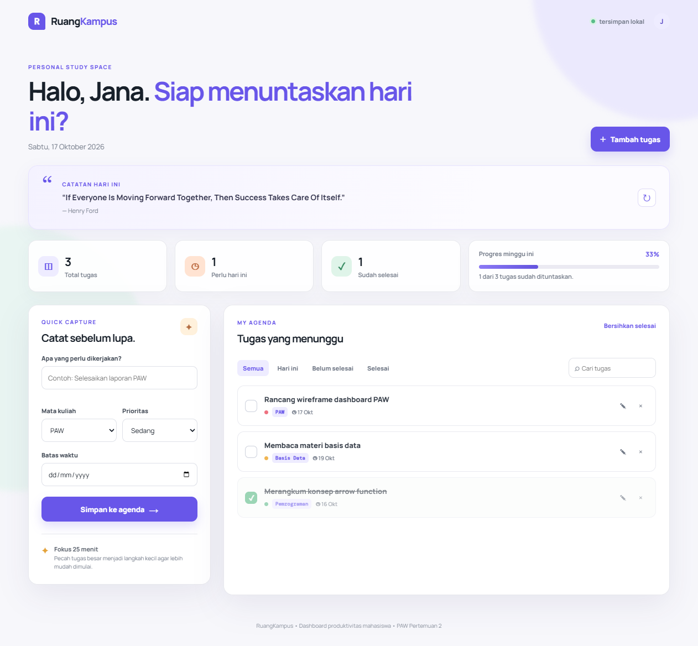
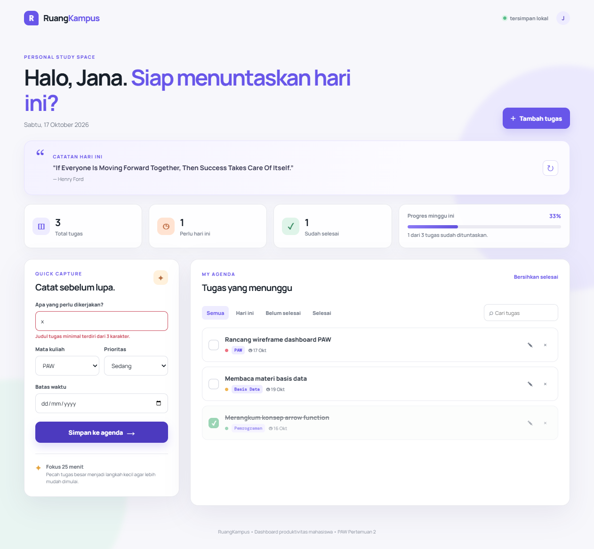
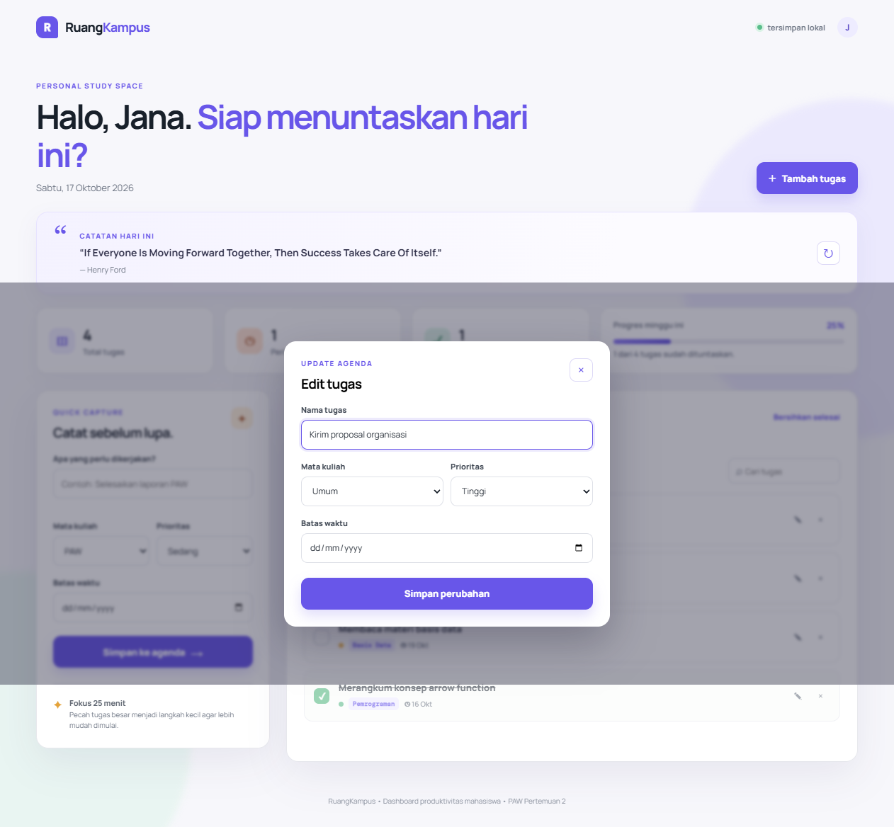

# RuangKampus - Personal Dashboard

> Tugas Praktikum Pengembangan Aplikasi Web - Pertemuan 2: JavaScript Next Gen (ES6+)

## Identitas

| Keterangan | Isi |
| --- | --- |
| Nama | Jana Rohman Wasiso |
| NIM | 123140046 |
| Kelas Praktikum | PAW RB |

## Deskripsi

**RuangKampus** adalah personal dashboard produktivitas untuk mahasiswa. Aplikasi membantu mencatat agenda kuliah secara cepat, melihat prioritas, memantau progres tugas, dan mendapatkan kutipan motivasi harian. Data tugas tetap tersimpan di browser sehingga agenda tidak hilang saat halaman dimuat ulang.

## Tujuan Pembuatan

Dashboard ini dibuat untuk membantu mahasiswa mengatur tugas kuliah dalam satu ruang kerja sederhana. Pengguna dapat mencatat tugas yang baru diberikan, menentukan prioritas serta tenggat waktu, lalu memantau tugas yang sudah diselesaikan tanpa memerlukan akun atau database eksternal.

## Fitur Utama

- CRUD agenda: tambah, edit, tandai selesai, hapus, dan bersihkan seluruh tugas selesai.
- Pencarian serta filter tugas berdasarkan semua tugas, hari ini, belum selesai, atau selesai.
- Ringkasan total tugas, tenggat hari ini, tugas selesai, dan progres mingguan.
- Penyimpanan data persisten menggunakan `localStorage` dan `JSON.stringify()`/`JSON.parse()`.
- Widget kutipan motivasi dari DummyJSON Quotes memakai `fetch()` dan `async`/`await`, dengan fallback offline.
- Desain responsif untuk desktop serta ponsel.

## Alur Penggunaan

1. Pengguna mengisi judul tugas, mata kuliah, prioritas, dan batas waktu pada panel **Quick Capture**.
2. Sistem memvalidasi judul tugas. Tugas yang valid langsung muncul pada daftar agenda.
3. Pengguna dapat mencari tugas, menggunakan filter status, menandai tugas selesai, atau menghapus tugas yang tidak diperlukan.
4. Tombol edit membuka form untuk memperbarui judul, mata kuliah, prioritas, dan tenggat waktu.
5. Ringkasan tugas dan progres diperbarui otomatis pada setiap perubahan, lalu data disimpan di `localStorage`.
6. Widget kutipan mengambil data asinkron dari DummyJSON dan tetap menampilkan kutipan cadangan jika koneksi gagal.

## Teknologi yang Digunakan

- **HTML5** dan **CSS3** untuk struktur serta desain dashboard responsif.
- **JavaScript ES6+** untuk classes, arrow functions, template literals, destructuring, spread operator, dan modern array methods.
- **Web Storage API** untuk menyimpan agenda secara lokal melalui `localStorage`.
- **Fetch API** dengan `async`/`await` untuk menampilkan kutipan motivasi.

## Struktur Folder

```text
Jana_Rohman_Wasiso_123140046_pertemuan2/
├── index.html
├── css/
│   └── style.css
├── js/
│   ├── main.js
│   ├── app.js
│   └── modules/
│       ├── data.js
│       └── utils.js
├── screenshots/
└── README.md
```

## Implementasi ES6+

| Fitur | Lokasi | Implementasi |
| --- | --- | --- |
| `let` dan `const` | `js/app.js:4`, `js/app.js:101` | Konstanta `STORAGE_KEY` memakai `const`; hasil filter yang diperbarui memakai `let filteredTasks`. |
| Arrow functions | `js/modules/utils.js:1`, `js/modules/utils.js:3`, `js/modules/utils.js:5`, `js/main.js:12` | Fungsi `formatLongDate`, `formatShortDate`, `isToday`, serta `getFormData` menggunakan sintaks arrow. |
| Template literals | `js/app.js:127`, `js/app.js:147` | `taskTemplate()` merender kartu tugas dinamis dan `loadQuote()` membentuk teks kutipan. |
| Classes | `js/app.js:7`, `js/app.js:31` | `TaskItem` memodelkan data tugas dan `DashboardApp` mengelola state, DOM, `localStorage`, serta API. |
| Destructuring | `js/app.js:8`, `js/app.js:100`, `js/main.js:18` | Destructuring parameter diterapkan pada `TaskItem`, `getSummary`, dan form edit. |
| Spread operator | `js/app.js:19`, `js/app.js:23`, `js/app.js:60` | Data disalin secara immutable pada `toggle()`, `update()`, dan saat menambah tugas. |
| Array methods | `js/app.js:66`, `js/app.js:101` | `map()`, `filter()`, `find()`, `sort()`, dan `some()` mengelola agenda. |
| Async/Await | `js/app.js:137` | `async loadQuote()` mengambil kutipan dari API DummyJSON dengan `try`/`catch`/`finally`. |
| ES modules | `index.html:91`, `js/main.js:1` | Entry point menggunakan `type="module"` serta `import`/`export`. |

## Menjalankan Aplikasi

1. Buka folder `Jana_Rohman_Wasiso_123140046_pertemuan2` di Visual Studio Code.
2. Jalankan `index.html` dengan ekstensi **Live Server**. Ini diperlukan karena aplikasi menggunakan JavaScript module.
3. Buka alamat yang diberikan Live Server di browser.
4. Tambahkan agenda melalui formulir, gunakan filter/pencarian, lalu muat ulang halaman untuk memeriksa `localStorage`.

## Tangkapan Layar

### Gambar 1. Tampilan Utama RuangKampus


Gambar 1 menunjukkan dashboard utama yang memuat kutipan harian, statistik agenda, indikator progres, formulir Quick Capture, dan daftar tugas mahasiswa. Data awal memberi contoh tampilan saat dashboard pertama kali dibuka.

### Gambar 2. Validasi Form Agenda


Gambar 2 menunjukkan validasi ketika judul tugas kurang dari tiga karakter. Pesan kesalahan muncul di bawah input dan tugas tidak akan disimpan sampai pengguna memasukkan judul yang valid.

### Gambar 3. Form Edit Agenda


Gambar 3 menunjukkan modal edit untuk mengubah data agenda. Setelah perubahan disimpan, daftar tugas, jumlah tugas, dan progres mingguan diperbarui secara otomatis.
