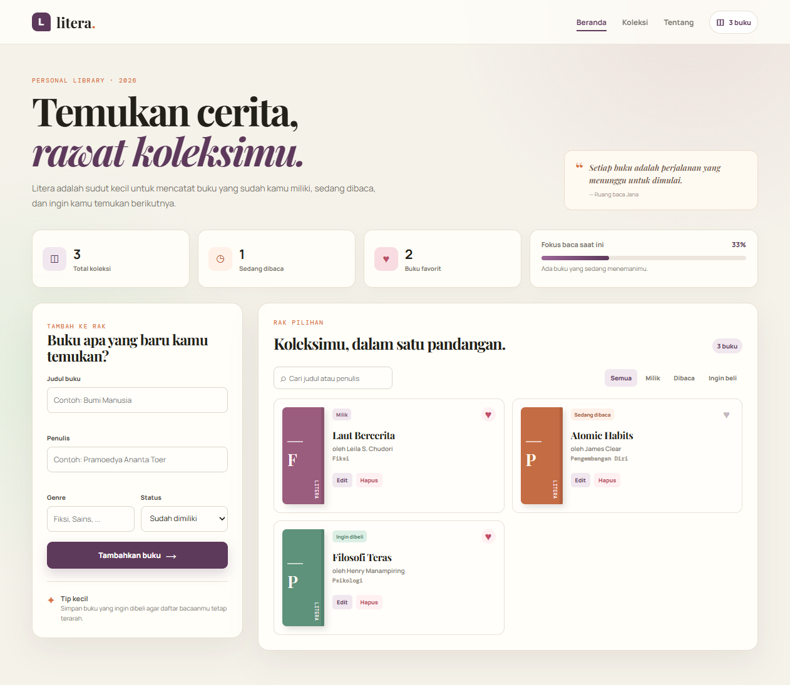
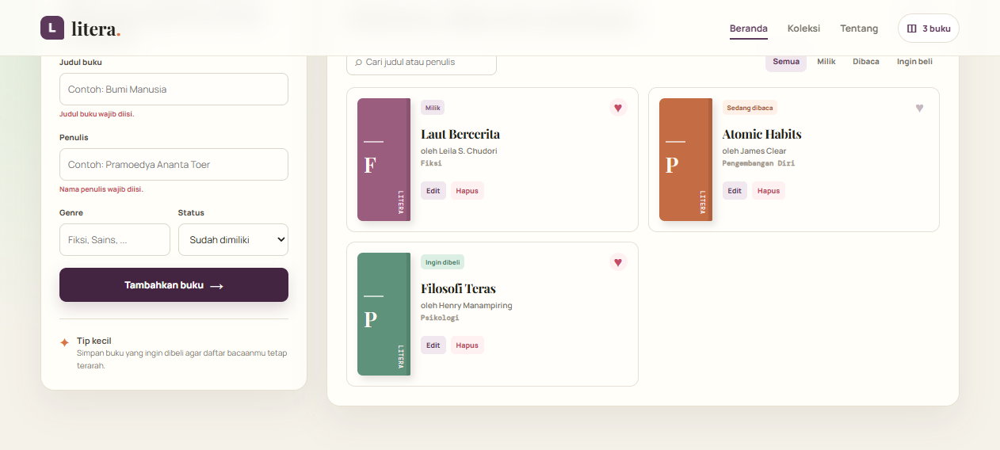
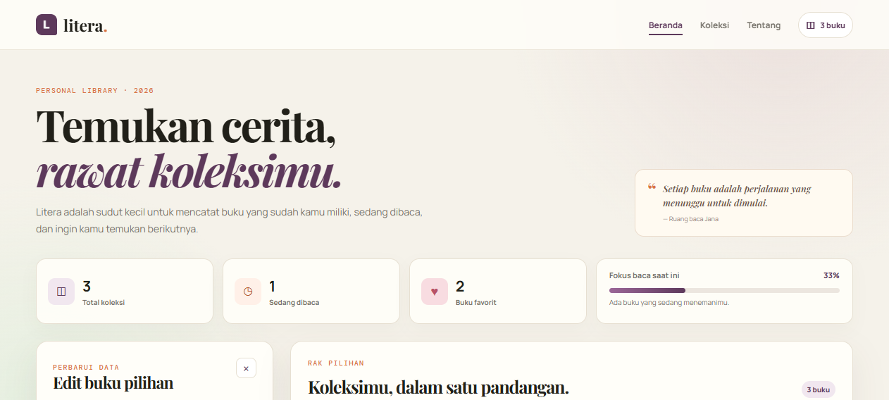

# Litera - Aplikasi Manajemen Buku Pribadi

> Tugas Praktikum Pengembangan Aplikasi Web - Pertemuan 3: React Basics

## Identitas

| Keterangan | Isi |
| --- | --- |
| Nama | Jana Rohman Wasiso |
| NIM | 123140046 |
| Kelas Praktikum | PAW RB |

## Deskripsi Aplikasi

**Litera** adalah aplikasi manajemen buku pribadi dengan tema rak baca digital. Aplikasi membantu pengguna mencatat buku yang telah dimiliki, sedang dibaca, atau ingin dibeli. Selain menjadi daftar koleksi, Litera menyediakan pencarian, filter status, penanda favorit, dan statistik agar pengguna dapat melihat kebiasaan membacanya dalam satu halaman yang nyaman dilihat.

## Tujuan Pembuatan

Tugas ini menerapkan konsep **Component-Based Architecture** React pada studi kasus yang relevan dengan mahasiswa: mengelola buku kuliah, buku bacaan, dan wishlist. Data disimpan di browser menggunakan `localStorage`, sehingga koleksi tetap ada setelah halaman di-refresh.

## Fitur Utama

- Menambah buku dengan judul, penulis, genre, dan status koleksi.
- Mengedit dan menghapus buku dari rak.
- Menandai buku sebagai favorit.
- Mencari buku berdasarkan judul atau nama penulis.
- Memfilter koleksi berdasarkan status: milik, sedang dibaca, dan ingin dibeli.
- Menampilkan statistik total koleksi, buku yang sedang dibaca, buku favorit, dan fokus baca.
- Menyimpan data koleksi secara persisten melalui `localStorage`.
- Menyediakan halaman Beranda, Koleksi, Tentang, dan halaman 404 melalui React Router.
- Menampilkan validasi visual jika judul atau nama penulis belum diisi.

## Teknologi React yang Digunakan

| Konsep | Implementasi |
| --- | --- |
| Functional components dan props | Komponen `Navbar`, `BookForm`, `BookCard`, `BookList`, `BookFilter`, dan `StatCard` menerima props dengan `PropTypes`. |
| `useState` dan controlled form | `BookForm` mengontrol seluruh nilai input dan feedback validasi. |
| `useEffect` | `useLocalStorage` menyimpan perubahan koleksi otomatis ke browser. |
| Context API | `BookProvider` membagikan data koleksi dan fungsi CRUD tanpa prop drilling. |
| Custom hook 1 | `useLocalStorage` menangani pembacaan serta penyimpanan JSON pada `localStorage`. |
| Custom hook 2 | `useBookStats` menghitung statistik koleksi secara efisien menggunakan `useMemo`. |
| React Router | `App.jsx` mengatur rute Beranda, Koleksi, Tentang, dan halaman Not Found. |
| Rendering list dan keys | `BookList` memakai `books.map()` dengan `key={book.id}`. |
| Immutable state updates | Context memakai spread operator, `map()`, dan `filter()` saat mengubah data buku. |

## Struktur Folder

```text
Jana_Rohman_Wasiso_123140046_pertemuan3/
├── src/
│   ├── components/       # Komponen reusable dan unit test
│   ├── context/          # BookContext dan BookProvider
│   ├── hooks/            # useLocalStorage dan useBookStats
│   ├── pages/            # Home, Collection, About, NotFound
│   ├── App.jsx           # Router dan Provider aplikasi
│   ├── main.jsx          # Entry point React
│   └── styles.css        # Styling global
├── screenshots/          # Bukti antarmuka aplikasi
├── index.html
├── package.json
└── vite.config.js
```

## Instalasi dan Menjalankan

Pastikan Node.js telah terpasang, kemudian jalankan perintah berikut dari terminal VS Code pada folder proyek:

```bash
cd Jana_Rohman_Wasiso_123140046_pertemuan3
npm install
npm run dev
```

Setelah Vite berjalan, buka alamat yang ditampilkan terminal (umumnya `http://localhost:5173`). Tekan `Ctrl + C` pada terminal untuk menghentikan development server.

## Pengujian Unit

Jalankan seluruh test dengan:

```bash
npm test
```

Hasil pengujian terakhir:

```text
Test Files  2 passed (2)
Tests       5 passed (5)
```

Lima test menguji render data buku, aksi favorit, hapus buku, validasi form kosong, dan pengiriman data buku valid. File test berada pada `src/components/BookCard.test.jsx` dan `src/components/BookForm.test.jsx`.

## Tangkapan Layar

### Gambar 1. Beranda dan Koleksi Buku


Tampilan utama Litera menampilkan statistik koleksi, formulir tambah buku, pencarian, filter status, serta kartu buku dengan informasi judul, penulis, genre, status, dan tombol aksi.

### Gambar 2. Validasi Form Buku


Ketika pengguna mencoba menambahkan buku tanpa judul dan penulis, aplikasi menampilkan feedback visual. Data tidak akan disimpan sampai kolom wajib diisi.

### Gambar 3. Edit Data Buku


Form yang sama digunakan kembali untuk mengedit buku. Nilai lama dimuat ke dalam input, kemudian Context API memperbarui koleksi dan `localStorage` setelah perubahan disimpan.

## Catatan Pengumpulan

- Repository: `pemrograman_web_itera_123140046`
- Folder tugas: `Jana_Rohman_Wasiso_123140046_pertemuan3`
- Folder `node_modules/` tidak diunggah karena sudah tercantum pada `.gitignore`.
