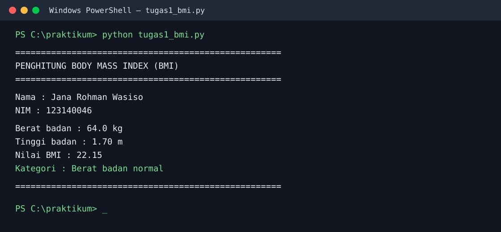
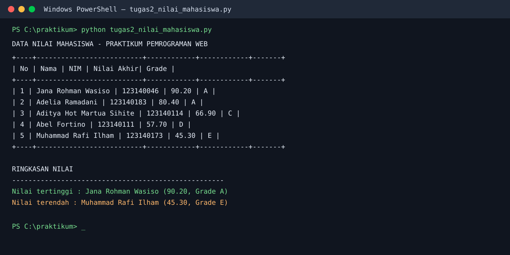
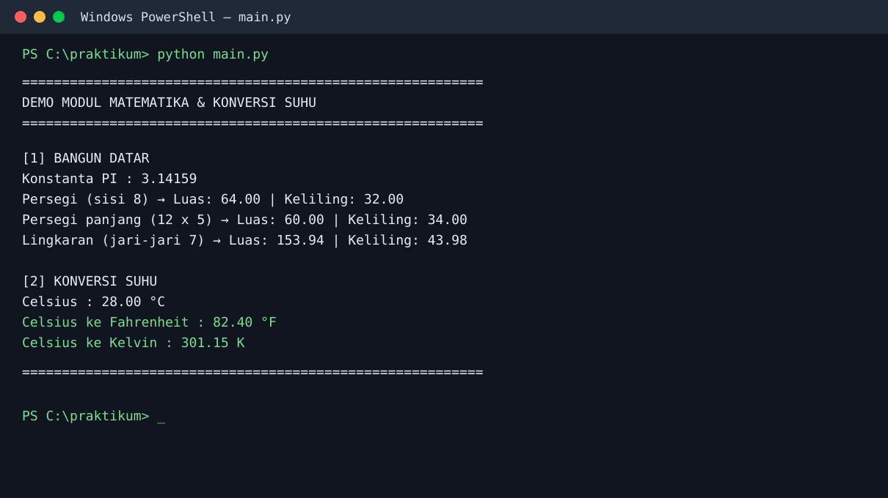

# Praktikum Pertemuan 4 — Dasar Pemrograman Python

## Identitas

| Keterangan | Data |
| --- | --- |
| Nama | Jana Rohman Wasiso |
| NIM | 123140046 |
| Kelas | PAW RB |
| Bahasa | Python 3.10+ |

## Deskripsi

Folder ini berisi tiga tugas Dasar Pemrograman Python. Implementasi memakai
penamaan `snake_case`, indentasi empat spasi, type hints, dan docstring pada
setiap fungsi agar kode mudah dipahami serta mengikuti konvensi PEP 8.

## Struktur Folder

```text
Jana_Rohman_Wasiso_123140046_pertemuan4/
├── tugas1_bmi.py
├── tugas2_nilai_mahasiswa.py
├── math_operations.py
├── main.py
├── screenshots/
│   ├── 01-bmi-terminal.svg
│   ├── 02-nilai-mahasiswa-terminal.svg
│   └── 03-modul-matematika-terminal.svg
└── .gitignore
```

## Isi Tugas

### 1. Penghitung BMI — `tugas1_bmi.py`

Program menghitung *Body Mass Index* memakai rumus `berat / tinggi²`.
Fungsi `tentukan_kategori_bmi()` menerapkan percabangan `if-elif-else` untuk
menentukan kategori berat badan kurang, normal, berlebih, atau obesitas.

### 2. Pengelolaan Nilai Mahasiswa — `tugas2_nilai_mahasiswa.py`

Program mengolah lima data mahasiswa berbentuk list of dictionary. Nilai akhir
dihitung dari UTS 30%, UAS 40%, dan tugas 30%; kemudian sistem menetapkan
grade A–E, mencetak tabel rapi, dan menemukan nilai akhir tertinggi serta
terendah.

### 3. Modul Matematika — `math_operations.py` dan `main.py`

`math_operations.py` menyediakan konstanta `PI`, fungsi luas dan keliling
persegi, persegi panjang, serta lingkaran, dan dua fungsi konversi Celsius.
`main.py` menjalankan seluruh fungsi dengan dua pola import: `import
math_operations` dan `from math_operations import ...`.

## Cara Menjalankan

Pastikan Python sudah terinstal, lalu buka terminal pada folder ini.

```powershell
cd Jana_Rohman_Wasiso_123140046_pertemuan4
python tugas1_bmi.py
python tugas2_nilai_mahasiswa.py
python main.py
```

Tidak ada dependensi pihak ketiga yang perlu diinstal.

## Bukti Hasil Eksekusi

### Soal 1 — BMI



### Soal 2 — Nilai Mahasiswa



### Soal 3 — Modul Matematika



## Validasi

Semua berkas telah dijalankan dengan Python 3.14.4 dan diperiksa sintaksnya
melalui `python -m compileall -q .`.
