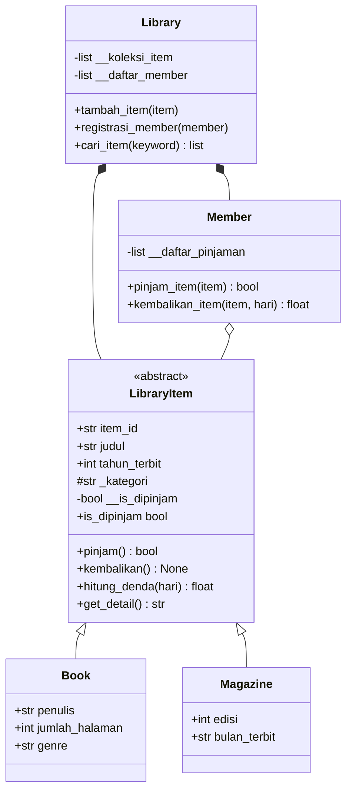
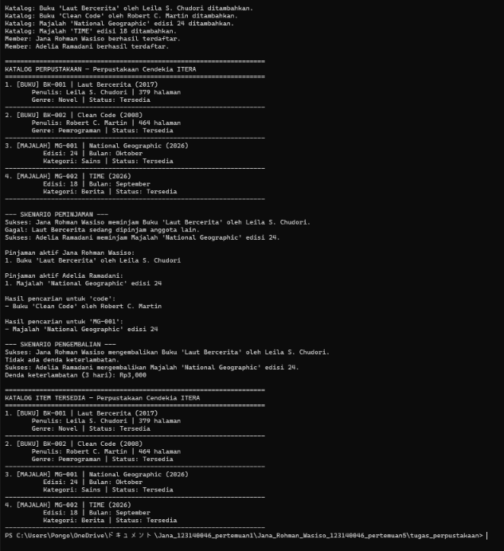

# Praktikum Pertemuan 5 — Python OOP

## Identitas

| Keterangan | Data |
| --- | --- |
| Nama | Jana Rohman Wasiso |
| NIM | 123140046 |
| Kelas Praktikum | PAW RB |

## Deskripsi

Tugas ini mengimplementasikan **Sistem Manajemen Perpustakaan Terpadu** berbasis
Object-Oriented Programming (OOP). Sistem dapat mengelola katalog buku dan
majalah, registrasi anggota, peminjaman, pengembalian, pencarian item, serta
perhitungan denda.

## Struktur Folder

```text
Jana_Rohman_Wasiso_123140046_pertemuan5/
├── tugas_perpustakaan/
│   ├── library_item.py
│   ├── member.py
│   ├── library.py
│   └── main.py
├── screenshots/
│   ├── 01-sistem-perpustakaan-terminal.png
│   └── output-sistem-perpustakaan.txt
├── README.md
└── .gitignore
```

## Arsitektur Class



## Implementasi Empat Pilar OOP

| Pilar | Implementasi |
| --- | --- |
| **Abstraction** | `LibraryItem(ABC)` mendefinisikan kontrak `hitung_denda()` dan `get_detail()`. |
| **Inheritance** | `Book` dan `Magazine` mewarisi atribut umum dari `LibraryItem`. |
| **Encapsulation** | Status pinjam, daftar pinjaman, koleksi, dan member menggunakan atribut private serta property aman. |
| **Polymorphism** | `Library.tampilkan_katalog()` memanggil `get_detail()` untuk buku dan majalah tanpa pemeriksaan tipe manual. |

## Alur Program

1. Membuat dua buku dan dua majalah, kemudian memasukkannya ke katalog.
2. Mendaftarkan Jana Rohman Wasiso dan Adelia Ramadani sebagai anggota.
3. Menjalankan peminjaman sukses dan percobaan meminjam item yang telah dipinjam.
4. Mencari item berdasarkan judul serta ID.
5. Mengembalikan buku tepat waktu dan majalah terlambat tiga hari untuk membuktikan perbedaan denda polimorfik.

## Cara Menjalankan

Tidak memerlukan dependensi eksternal. Pastikan Python 3.10+ telah terinstal,
kemudian jalankan perintah berikut dari terminal VS Code:

```powershell
cd Jana_Rohman_Wasiso_123140046_pertemuan5\tugas_perpustakaan
python main.py
```

## Bukti Hasil Eksekusi



Hasil teks lengkap juga tersedia pada
`screenshots/output-sistem-perpustakaan.txt`.

## Validasi

- `python -m compileall -q Jana_Rohman_Wasiso_123140046_pertemuan5`
- Menjalankan `python main.py` untuk seluruh skenario operasi perpustakaan.
- Atribut cache Python dan virtual environment diabaikan oleh `.gitignore`.

